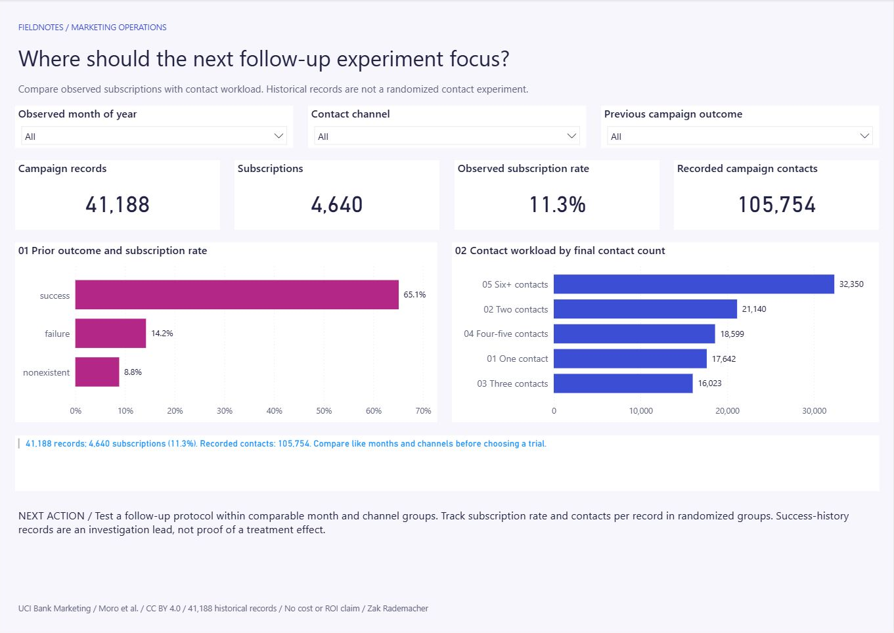

# Marketing Campaign Performance

**Where should a prospective follow-up experiment focus, given observed subscriptions and contact workload?**

The historical source has **41,188 campaign observations, 4,640 subscriptions (11.3%) and 105,754 recorded contacts**. Previous-success observations have a 65.1% subscription rate, but they are a selected population, not evidence of campaign lift.

The new Python/SQLite companion compares success/failure history within the same observed month and channel. In **May / cellular**, rates are **103/214 (48.1%) versus 130/1,661 (7.8%)**. The difference remains descriptive; month names pool years and final contact counts are not randomized treatments.

[View current preview](deliverables/dashboard-preview.png) · [Download current PBIX](deliverables/Marketing%20Campaign%20Review.pbix) · [Comparison and memo](docs/OUTCOME_COMPARISON.md) · [SQL](sql/matched_outcomes.sql) · [Reproduce](#reproduce)



Power BI retains its current star model and calculations. Its first-page finding responds to that page's slicers; pages have independent selections. [Existing decision memo](docs/DECISION_MEMO.md) · [Worked prospective experiment proposal](docs/EXPERIMENT_PROPOSAL.md) · [All 20 comparison cells and controls](deliverables/outcome-comparison).

## Open the report

[Imported-data Power BI workbook](deliverables/Marketing%20Campaign%20Review.pbix). Open in Power BI Desktop. Editable source: [CampaignReview.pbip](powerbi/CampaignReview.pbip).

For refresh on a new machine, open the PBIP, set the DataFolder Power Query parameter to this project's absolute `data/processed` folder, then Home > Refresh. The five related CSV tables must stay together. Each page has independent slicers; the live selection finding on page one responds to its slicers. Run `python tools/build_report.py` only when intentionally regenerating the editable report layout.

## Reproduce

Python 3.10+, standard library only:

```sh
python tools/download_data.py
python refresh.py
python tools/compare_outcomes.py
python -m unittest discover -s tests -v
```

The preparation writes source-row lineage, a SQLite database, reporting CSVs, comparison cells and [control totals](data/processed/controls.json). [SQL investigation](sql) shows counts and denominators explicitly. Source records are retained; repeated-looking rows without durable IDs are not automatically removed.

The new comparison reads the prepared SQLite database without modifying it and writes reproducible CSV/control files. Missing-group rates and gaps remain blank; other-outcome records remain in all-record controls. [Walkthrough, source reconciliation and practice](docs/OUTCOME_COMPARISON.md).

## Read the analysis

- [Source, version and licensing](docs/SOURCES.md)
- [Measure definitions and refresh boundaries](docs/METHOD.md)
- [Beginner walkthrough and practice](docs/LEARNING.md)
- [Verification](docs/QA.md)

Independent portfolio demonstration. Historical associations motivate a controlled follow-up experiment; they do not establish causal lift, profit or realized client outcomes. The previous Retail and Complaint projects remain available as separate supporting work.

## Presentation history

[Cover preview](deliverables/portfolio-cover-wide.png) · [Motion cover](deliverables/portfolio-motion.webm) · [Design maintenance](docs/VISUAL_DESIGN.md) · [November 1 release record](docs/DASHBOARD_RELEASE.md). Covers are presentation assets; native report behavior is documented separately.
